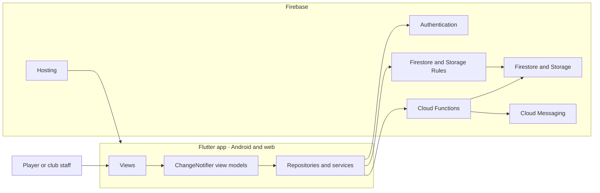

# Architecture overview

## System shape

The same Flutter application serves Android and the web PWA. UI code calls view models; repositories and services own persistence and Firebase access. Firebase Security Rules protect client access, while Cloud Functions perform privileged operations.

## Application boundaries

- **UI:** localized Flutter views and view models; widgets do not call Firebase directly.
- **Data:** repositories and services implement reads, writes, uploads and callable-function requests.
- **Domain:** immutable models represent users, organizations, teams, competitions, matches and related records.
- **Backend:** Firestore stores tenant-scoped data; Storage holds user and club images; Cloud Functions handle trusted writes, scheduled work and notification dispatch.

## Access and tenant isolation

Organizations contain teams; teams contain competitions and matches. Membership determines a user's team access. Firestore and Storage Rules deny access by default and enforce membership and role checks. The client cannot assign roles or permissions. Cloud Functions validate authentication, App Check and authorization before privileged writes.

Firebase Authentication manages sign-in. Cloud Messaging delivers notifications. App Check protects supported client and callable-function access. The app targets Android and web; platform-specific capabilities such as web push are handled by the client layer.

## Environments and verification

Local development uses Firebase emulators. A separate development environment supports requested integration checks; production configuration and deployment remain owner-controlled. Cloud Functions and Firestore are configured for the project's European region; Storage uses its separately configured region.

Verification follows the changed boundary: Flutter format, analysis and tests for app changes; function lint, build and tests for backend changes; emulator rules tests for data-access or rule changes. UI work is checked against the design references during implementation.
